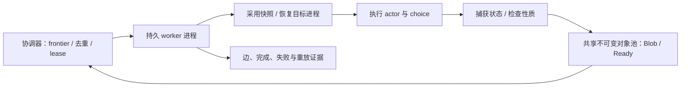

# 并行性能优化归档

归档日期：2026-10-24。这里的“并行”指 DetSim 多 worker **进程**协作探索状态空间，
不是被测程序的 pthread 支持，也不是将 tracer 改成多线程。

**当前决定：暂停这条优化线。尚未达到接近线性加速，未证明已经到达硬件上限。**
最近的 journal、共享映射原型没有进入产品。本文记录设计、证据、放弃理由与恢复
入口，避免以后从零重做。归档操作没有恢复 goal，也没有运行新实验。

## 1. 目标、底线与当前水平

目标是提高完整状态空间探索吞吐和并行加速比；允许合理资源取舍，但不能牺牲
状态恢复、分支隔离、完整探索或明确失败语义。降低某个缓存/存储操作耗时，不等于
完整搜索更快；构建成功、案例能运行或性质检查没报错，也不等于通用模型检验正确。

最近同一次 WSL 启动下的 Raft-library depth16 基线如下。目标不是完整 Redis 服务。
图为 **63418 状态、112305 边/尝试边、零重试**；1-worker 一个样本，其他各两次。

| workers | 原生自动搜索耗时 | 相对单 worker |
| --- | ---: | ---: |
| 1 | 144.7805 秒 | 1× |
| 12 | 18.0474 秒，中位数 | 8.02× |
| 24 | 16.0163 秒，中位数 | 9.04× |

机器是 Ryzen 3900X、12 核 24 线程、Windows 10/WSL2。24 workers 比 12 workers
吞吐高约 12.7%，但 **24 workers 不是 24 个物理核**；不能重命名资源口径来宣称
接近线性。这也不是完整扩展曲线、置信区间或对其他程序的承诺。
详见[硬件线程对照](../hardware-threads-search-2026-10-24.md)。

## 2. 当前架构和必须保持的契约

- 实际探索由内置 parallel/BFS/DFS/RAND 完成。Python 只负责准备、启动、观测、
  图核验和重放，不能另写一套 Python 搜索来替代框架性能。
- worker 复用受控 tracees 和恢复设施；共享 frontier/lease 负责去重、工作归属、
  失败重派及 cutoff。不要把零输出状态或已有证明缓存命中直接等同于无需校验。
- 默认 shared 路径用同机不可变 CAS 与小引用通信；durable 路径保留完整 bundle。
  “已经共享文件”不意味着解码后的堆内存也跨进程共享。
- Ready 发布前必须满足依赖闭包。校验、哈希冲突比较、typed namespace、只读限制、
  poison、冷重开与缓存淘汰必须保持，不能以缓存命中制造成功。
- resident memory proof 只证明其明确覆盖的内存，不自动证明寄存器、信号、线程
  绑定和所有内核状态不变；不能据此跳过整套恢复或停止校验。
- 主干已经包含共享池/证明缓存、same-cpu 可选放置、expanded task 首次重复恢复
  消除等基础设施，以及类型化 `(Kind, hash)` 缓存键。后者有小幅绝对提速证据；
  另修复过线程枚举把 readdir 错误当 EOF 的正确性问题，不冒充性能收益。

入口与契约：[开发说明](../development.md)、[状态/原子性评估](../model-checking-contract.md)、
[正确性 backlog](../correctness-backlog.md)、[共享池演进](../shared-pool-scaling-2026-10-19.md)、
[类型化缓存键](../typed-pool-cache-2026-10-23.md)。

## 3. 最重要的诊断结论

### 等待、额外工作、每份工作的执行成本必须区分

1. 独立单-worker 搜索并发运行也退化，因此不能只归罪于共享 frontier 或通信协议。
   但独立任务聚合吞吐不是固定总图的加速比，更不是硬件上限。
2. WSL 旧版任务窗口的 worker-main on-CPU 占比约 97%–98%，同图累计 on-CPU 增长
   约 41%。guest on-CPU 不等于有效指令或宿主持续运行，不能据此排除虚拟化因素。
3. 新版宿主采样中，12→24 workers 的加权忙碌 VP 数约 **11.84→17.25**，覆盖窗口
   约 91%/94%。更多 vCPU 确实在运行，但没有持续占满 24；不同覆盖区间不能直接
   除以完整图工作量，计算精确的每任务 CPU 成本。
4. 完整命令边界的 guest CPU 记账：协调器 **11.29→11.48 秒**，回收子进程
   **192.79→272.09 秒**，合计增加约 **39%**。协调器平均约 0.63/0.70 个核，
   不支持它一直被 CPU 跑满，但不能排除短时瓶颈或阻塞。
5. 原生 Ryzen 2600（6 核 12 线程，非 WSL）同图 1→12 workers，指令/边约 +9%，
   周期/边约 +64%，通用缓存 misses/references 约 24.8%→24.4%。比值不变不能
   排除 L3/内存延迟；不能把通用事件误叫普适 LLC miss rate。
6. 原生用户态 IPC 1.33→0.83，内核态 0.55→0.41。保持 12 workers、避开 SMT
   sibling 后 IPC 回升，但搜索变慢：减少同时执行的硬件线程不是免费优化。

证据：[任务窗口](../worker-cpu-scaling-2026-10-23.md)、[宿主观察](../host24-cpu-2026-10-24.md)、
[完整命令 CPU](../command-cpu-2026-10-24.md)、[缓存事件](../native-cache-counters-2026-10-24.md)、
[用户/内核及 SMT](../native-privilege-counters-2026-10-24.md)、
[独立搜索控制](../independent-search-control-2026-10-23.md)。

### 不应反复从头验证的方向

| 路线 | 已有结果与决定 |
| --- | --- |
| `/proc/<tid>/status` fd 复用 | 保留每次实时读取和身份绑定；单 worker 约快2.9%、12 workers约快2%，加速比未提高，未采用。不能缓存“没有信号”。 |
| hot cache 32→64 MiB | 逐出可以消失，搜索耗时基本不变；不提高默认容量。 |
| 恢复父页作为比较提示 | 保留全量活内存读取和逐字节比较；12-worker 页面保存调用少约32%，搜索基本持平，未采用。 |
| roots 查找、view 索引、页表复用/reserve、cache-owner 复用 | 局部节省不等于全链路收益；已有候选和报告，未得到足够稳定收益，不盲目重试。 |
| 派发批量/共享存储位置 | 已有诊断；没有证据支持只增加批量或换 tmpfs 就解决扩展问题。 |
| 宿主 vmmem affinity | 对算术控制明显、对真实搜索仅约2%的小变化；已恢复默认，不保留宿主修改。 |
| 24-worker 不绑核 | 两轮都不如 same-cpu，中位吞吐约低6%；保留本案例实验设置，不更改通用默认。 |
| journal 普通 edge/node 批量 flush | 保留关键事件/违规/summary 即时刷新；四对三快一慢，合并中位仅快1.2%，不足以抵消活日志/异常退出尾部可见性取舍，未采用。 |
| 不扩容时省载体检查 | 实测 ensure/query_clear_tid 各1793次，对比147598次 verify；只有频率证据，没有足够耗时/正确性证明，未删检查。 |

详细记录：[fd 复用](../proc-status-reader-2026-10-23.md)、[缓存容量](../hot-cache-capacity-2026-10-24.md)、
[父页提示](../restored-page-hint-2026-10-24.md)、[journal](../journal-batching-2026-10-24.md)、
[工作量计数](../worker-work-accounting-2026-10-24.md)、[宿主 affinity](../host-affinity-pilot-2026-10-24.md)。
fork 捕获曾讨论但因改造成本高、收益不确定放弃；本轮没有实现，勿误认为已有可用分支。

## 4. 最后推进的方案：共享解码后字节

### 为什么值得尝试

SharedObjectPool 原实现读取后分配/解压到每个进程自己的 `vector`。独立控制中，
共享文件映射与私有工作集的扩展表现不同，提示实际共享解码后字节可能有价值。
这只是动机，不是 DetSim 的缓存瓶颈或 mmap 收益证明。

### 原型设计

- `ImmutableBytes` 统一只读 data/size/iterator 所有权，内部为堆 vector 或只读
  MAP_SHARED；保持关闭 fd、unlink、淘汰后 held owner 的有效性。
- 保持 version1 codec0/codec1、类型/长度/键/校验和、冲突、原子发布与 poison。
  原始对象可映射，旧压缩对象仍验证后解压。不能直接 mmap 压缩内容当解码内容。
- StateStore、SnapshotView、resident page、捕获/恢复的只读 owner 统一迁移；
  packed 输入用 span，完整 bundle/copy-out 显式复制。VFS 暂用复制适配保留原接口。
- producer L1 在原容量条件内复用已发布 owner。该改动也存在于控制版本，不能
  将其效果全部归给 mmap。所有受影响 tracer 翻译单元必须重编译；实际插件 C ABI
  未变，不意味着内部 C++ ABI 没变。
- 保留原不可变文件使用期契约。外部修改/truncate 不受支持，映射可能反映修改或
  触发 SIGBUS；不能因用了 shared_ptr 就宣称可容忍这类变化。
- 67405 个 Ready 对象全小于4KiB，Blob只有5895个，因此另做仅映射≥4KiB的策略。
  小对象逐个映射可能增加 VMA/TLB/页开销，虚拟映射量也不是 RSS/PSS。

### 已验证与未获得的收益

所有权/只读保护、ASan/UBSan、跨旧新格式冷读取、对象池并发/损坏/淘汰/poison、
共享 StateStore/快照集成、packed/mapped×normal/tiny 四组全字节 oracle、原生失败/
重放检查及四种原型各自的 depth16 参考均有证据。**这些不等于性能有效。**

五版本 W24 正反顺序各两次，完整图、输入和原始日志审计通过：

| 版本 | 原生搜索中位数 | 相对原基线 |
| --- | ---: | ---: |
| 原 typed-pool | 16.1278 秒 | — |
| 新接口，压缩堆 | 18.4216 秒 | +14.22% |
| 新接口，原始堆 | 18.4342 秒 | +14.30% |
| 全部映射 | 20.1459 秒 | +24.91% |
| 仅映射大对象 | 18.1426 秒 | +12.49% |

**该实现不应直接合入。** 新接口的压缩堆控制也退化，须先隔离公共表示/owner 复用/
构建布局等差异，不能把全部损失归到 mmap。编译器版本一致，并不排除构建差异。
共享池已分配磁盘由约316.6 MB增至389.8 MB；不能用这个数推断内存收益。
见[原型及全部验证记录](../mapped-pool-prototype-2026-10-24.md)。

## 5. 暂停时的精确恢复点

- goal 为 **paused**。归档并不授权继续自动实验。
- 五版本计时已审计；其可再生快照已清理，图、配置和日志保留。
- 五版本独立资源采样已完成、退出码记录为0，证据已下载至
  `build/shared-parallel/mapped-pool-resources/evidence.tar`。**尚未做独立审计，不能
  报 PSS/RSS 收益，也不能将带采样耗时混入上表。** 远端这批生成存储清理尚未核验。
- `build/shared-parallel/rebuilt-typed-baseline/build-manifest.json` 已显示完整构建成功，
  binary SHA 为 `7d2bf2447b70016574c52e22a851da059ae85651b076d9955f0fcbdaec0b2b6c`。
  这是归档时核实的状态；尚无图/计时对照，不能说已排除重编译影响。
- 辅助 DSH 会话均已归档。归档时本机未发现上述构建/实验进程；远端状态和临时
  WSL 保活必须在恢复时重新核实，旧 PID/exec handle 不可当活跃任务证据。

## 6. 将来恢复时的路线

1. **恢复证据而非重跑一切。** 先审计已取回资源数据，区分观测峰值、未采到的进程、
   非原子 PSS 汇总、实际共享映射及虚拟范围；核对参考和二进制身份。
2. **隔离公共退化。** 用新重编译的原实现对比冻结原基线。若一致，再单独区分新
   字节表示和 producer owner 复用。先找热点/指令/工作量变化，勿猜测 variant
   分支或对象尺寸就是14%的原因。
3. **只有内存收益值得时才继续映射线。** 可能方向是更轻的只读表示、只映射大块、
   合并小对象、共享解码副本；它们均未验证，可能引入生命周期、空间和回收成本。
   不做 vector 布局破解、全局 allocator 替换或放弃校验来制造零复制。
4. **回到真正的扩展损失。** 分清重复工作、每工作单位执行成本、协调器短时瓶颈、
   guest/host 调度和缓存/SMT。只有有区分力的新实验才值得跑；不要再仅凭 syscall
   数量、busy CPU 或单个热点份额给出因果结论。
5. **采用门槛。** 先比较正确性、失败/淘汰/冷重开与完整图，再做正反顺序的同版
   1/12/24 对照。改善绝对耗时不一定改善加速比；资源诊断单独运行。证明收益足够
   承担维护和取舍后，才走生产代码审查、构建/测试与自主提交，不默认推送。

未来若需要更强硬件归因，可考虑真正的12物理核原生 Linux 对照或可用 PMU；当前
原生6核与 WSL12核数据不能直接互代。没有这些条件时应明确结论边界，不宣称无法
再提高，也不无限重复已有否定实验。

## 7. 测量、运维与源码附件

- 主性能口径是 tracer 原生自动搜索 `receipt.seconds`/`search_metrics`。旧报告有
  命令至提示符、延迟关闭等不同口径，保留原限定，不能混算。
- 串行参考只独立验证节点及首次父边；完整规范图另外核对。固定图一致不等于
  任意内存等价或通用状态/原子性契约全部满足。
- 两份常用图：depth12 为10457/18266，SHA `56ccf7cc9b866e62f6da715136eb596719b3f2b101915e93e4cf0c630217717b`；
  depth16 为63418/112305，SHA `7eba9a268e4fd2bc45bce49b59c02e85389b743c53a9a25214d59dd3569f2630`。
- 原生 perf 可用路径为 `/usr/lib/linux-tools-6.8.0-138/perf`；另一个旧路径缺 libperl。
  WSL 私有 perf 支持软件/调度事件，未建立硬件 PMU 可用性。恢复时重新探测，不改
  NMI watchdog、ASLR、电源或宿主 affinity 来掩盖问题。
- gpunode 为192.168.1.8；Windows 为192.168.1.5；实验 rootfs 在
  `/home/asaaoi/exp/detsim-scaling-20261019-3fb4274f/`。地址/运行状态不是永久保证。
- 曾因 Windows D: 耗尽而 WSL I/O 失败，虽然 guest df 仍显示大量可用空间。
  已清理压缩回收约58.8 GB；之后每项检查宿主余量，低于15GiB不启动下一项。
  [恢复记录](../wsl-storage-recovery-2026-10-24.md)。不得仅查 guest 空间。
- 同一机器不要并发跑 CPU 实验；采集完成且证据核验后清理生成快照/重复二进制。
  不删除待审计数据，不把 snapshot 已清理误说成仍能直接 load 旧现场。

附件目录：[源码差异与关键结果](parallel-performance-2026-10-24/README.md)。其中保留
mapped-pool/journal 原型补丁、只读字节及日志测试文本、关键已审计结果和校验清单。
补丁是设计留档，**不是可直接投产的实现**。大量原始日志、perf、二进制和工作树
仍在被 git 忽略的 `build/shared-parallel/`，不随 Git 搬迁；它们的存在与证据等级
必须重新核实，不能只凭旧 progress.md 中的“通过/运行中”继续。
